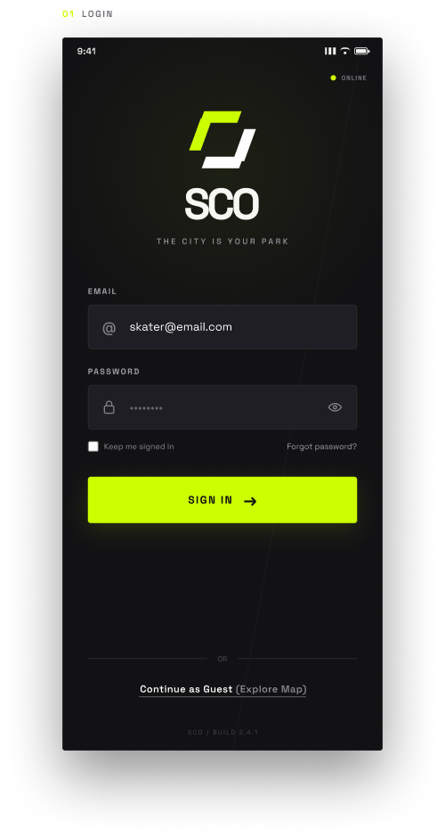
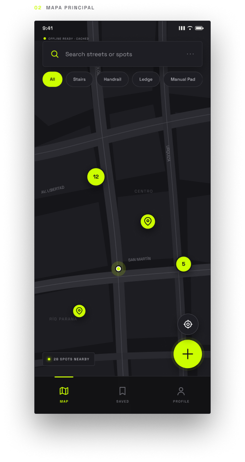
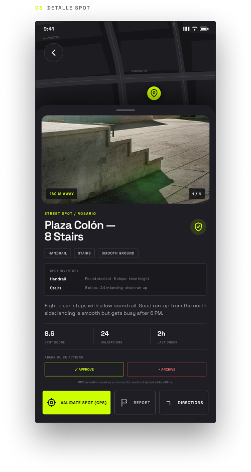
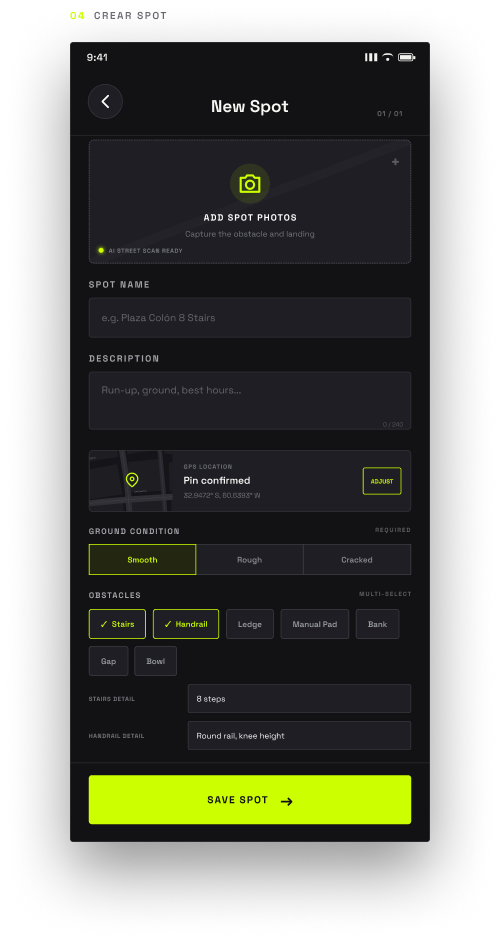
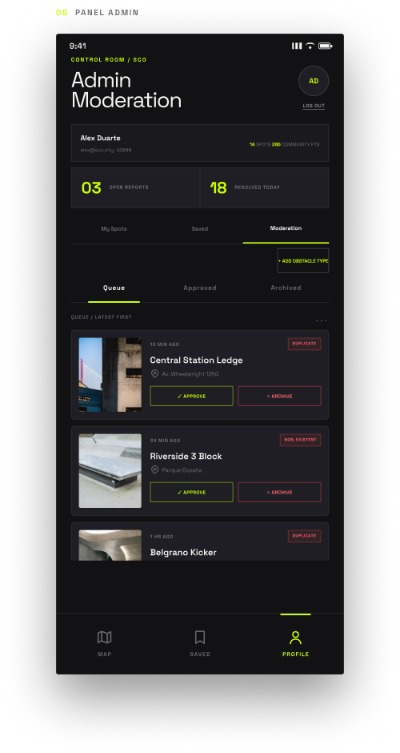
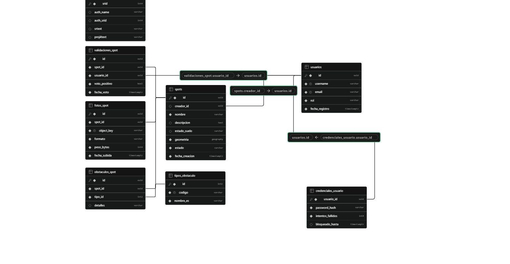

<div align="center">

# SkateCO

**`spots urbanos · skate · Android`**

[](https://github.com/DiegoFernandoMarquezRamos/SkateCO/actions/workflows/android-ci.yml)


</div>

```bash
$ whoami
SkateCO — proyecto de fin de ciclo para descubrir y catalogar spots urbanos.

$ git status --short
Android: prototipo de interfaz en Kotlin y Jetpack Compose
Base de datos: esquema inicial PostgreSQL + PostGIS
Backend: planificado; todavía no integrado

$ ./gradlew test
```

## ¿Qué es SkateCO?

Una aplicación Android para explorar y documentar lugares aptos para skate y otros deportes urbanos. El repositorio contiene actualmente un prototipo de interfaz, navegación entre pantallas y un primer diseño SQL; la autenticación real, la persistencia, la sincronización y los servicios backend siguen en desarrollo.

## Lo que encontrarás

- Pantallas de acceso, mapa, detalle de spot, creación y perfil/moderación.
- Navegación Android con Jetpack Compose y Material 3.
- Esquema SQL inicial con PostgreSQL/PostGIS y datos de ejemplo para Madrid.
- CI en GitHub Actions que ejecuta los tests Android.

## Diseño de Interfaz (Figma)

<div align="center">
<table>
  <tr>
    <td align="center"></td>
    <td align="center"></td>
    <td align="center"></td>
    <td align="center"></td>
    <td align="center"></td>
  </tr>
</table>
</div>

## Stack actual

| Área | Tecnología |
| --- | --- |
| Aplicación | Kotlin, Android, Jetpack Compose, Material 3 |
| Navegación | Android Navigation Compose |
| Modelo de datos inicial | PostgreSQL, PostGIS, SQL |
| Calidad | Gradle, JUnit, GitHub Actions |

### Arquitectura prevista y Modelo de Datos

El anteproyecto contempla un backend con Spring Boot y Java, además de funcionalidades *offline-first* y servicios geoespaciales. Son objetivos de desarrollo, no componentes ya integrados en esta versión.

<details>
<summary><b>Ver diagramas de Arquitectura y Esquema PostgreSQL / PostGIS</b></summary>
<br/>
<div align="center">
  <p><b>Arquitectura del Sistema</b></p>
  
  <br/><br/>
  <p><b>Modelo Relacional (PostgreSQL + PostGIS)</b></p>
  
</div>
</details>

> Documentación técnica completa en [`docs/Analisis_Funcional_SCO.md`](docs/Analisis_Funcional_SCO.md).

## Ejecutar la aplicación

1. Abre `Aplicacion/` en Android Studio con JDK 17 y el SDK de Android requerido por Gradle.
2. Ejecuta el módulo `app` en un emulador o dispositivo compatible (Android 12 / API 31 o superior).
3. Para ejecutar los tests desde terminal:

   ```bash
   cd Aplicacion
   ./gradlew test
   ```

El esquema inicial de base de datos está en `base_de_datos_SCO.sql` y requiere PostgreSQL con las extensiones `uuid-ossp` y `postgis`.

## Estado del proyecto

Este repositorio es un proyecto académico en evolución. La interfaz sirve como prototipo; las acciones de autenticación y guardado no sustituyen todavía a un backend ni a persistencia real.

## Licencia

Aún no se ha definido una licencia para reutilización del código.
